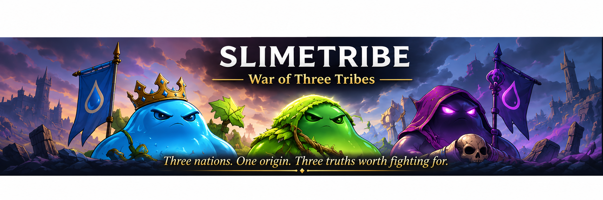
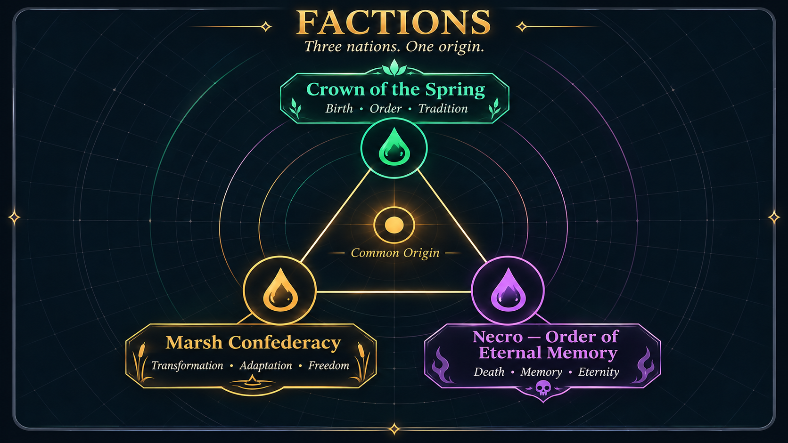

<div align="center">



# SlimeTribe

**Three nations. One origin. Three truths worth fighting for.**

**A fantasy adventure and tactical RPG about a world running out of life.**

    

</div>

> The springs are dying. The three slime civilizations share a single ancestry, but no longer agree on what must be saved — or who deserves to survive.

SlimeTribe combines **real-time 3D exploration**, **turn-based grid combat**, story-driven quests, cutscenes, and built-in creation tools. Its homegrown JavaScript runtime is built to produce a **self-contained HTML game** that can run directly from `file://` without an application server, package manager, or external JavaScript framework.

## The world



- **The Crown of the Spring** (*Koruna Pramene*) — birth, order and tradition. Disciplined defenders, healing and control of the remaining springs.
- **The Marsh Confederation** (*Bažinná konfederace*) — adaptation, freedom and transformation. Mobile forces, poison, terrain control and survival in hostile landscapes.
- **Necro, the Order of Eternal Memory** (*Řád věčné paměti*) — remembrance, the dead and preserved essence. Summoning, attrition and the unsettling cost of immortality.

The planned narrative tells **one war from three perspectives**. Each faction holds part of the truth and bears responsibility for the world's crisis. The story concept, including the three campaigns and their possible endings, remains **alpha lore, not finalized canon**.

## What's in the current build?

| Area | Current state |
| --- | --- |
| Adventure | 3D exploration, interactions, party/RPG systems and quest objectives |
| Battle | Turn-based tactical grid combat with enemy AI, abilities and status effects |
| Story | Playable quest content Q01–Q04, dialogue and scripted cutscenes |
| World | Procedural architecture, environment props and quest-object visuals |
| Audio | Built-in music/SFX runtime and audio workstation tools |
| Editors | Adventure/map, scenario and cutscene editing tools |
| Languages | Czech and English player-facing localization; grammatical forms supported for Czech |
| Rendering | WebGL rendering and a fallback 2D path |
| Delivery | Single-file offline HTML export; source split into readable modules |

**Not yet complete:** the full three-campaign story, later quests beyond Q04, final narrative branching, production polish and comprehensive real-device/browser QA. Some development/editor interfaces are still in Czech. A release-quality finished game is **not** implied by the phase number.

## Play offline

The source archive includes a prebuilt HTML game in `dist/`.

1. Download or clone the repository.
2. Open the latest `dist/SlimeTribe-Phase*.html` directly in a modern browser.
3. Start the game in **Adventure** mode; use its interface for quests and encounters.

No HTTP server is required for the distributed HTML build. Browser features and graphics support vary by device; audio may require a user gesture to unlock. If WebGL is unavailable, the project contains a fallback 2D renderer.

## Build from source

Requirements: **Python 3** for assembly and **Node.js** for the JavaScript test suites. Native GPU checks additionally depend on optional local graphics/testing libraries.

```bash
python3 build.py
```

The command assembles the split JavaScript, content data, models, localization and styles into a standalone HTML file under `dist/`. It also updates generated source artifacts as part of its current workflow; use a clean working tree when rebuilding.

Run the project tests:

```bash
python3 tests/run.py
```

Optional native/GPU checks (requires the corresponding environment):

```bash
python3 tests/run.py --native --gpu
```

The Phase 12.9 development notes report **35 passing test suites**, including native Mesa EGL rendering checks. These are not a substitute for visual testing in real desktop/mobile browsers.

## Repository structure

```text
SlimeTribe/
├── build.py                  # Bundles standalone HTML
├── src/
│   ├── game/                 # Adventure, battle, quests, scenes, editors, UI
│   ├── content/              # Q01–Q04 campaign/quest data
│   ├── locales/              # CZ/EN catalogs
│   ├── snd/                  # Audio engine and song/sample code
│   └── ...                   # Eldor-derived runtime and rendering modules
├── vendor/                   # Supplied Eldor source and character models
├── tests/                    # Regression and rendering checks
├── docs/                     # Detailed phase notes
│   └── images/               # GitHub README graphics
└── dist/                     # Built playable HTML
```

## Design principles

**Adventure first, tactical battles when the story calls for them.** Locations and objectives are data-driven, with editor support rather than hardcoded scenario scripts. The game emphasizes meaningful faction differences, quests with persistent consequences, and accessible offline play.

Maps, story data, character models, sounds, and rendering code are being refined independently. The long-term design calls for fast transitions between strict 128×128 Adventure maps, extensible localization, and richer campaign-specific interactions.

## Roadmap

- Expand the Adventure journey and quests beyond Q04.
- Continue the three-faction story, character relationships and consequential decisions.
- Improve editor workflows and mobile UX; verify on actual devices.
- Refine imported character orientation and asset integration.
- Extend automated tests and perform real-browser regression passes.

These are development goals, **not promised shipping dates**.

## Game Bible

The accompanying **SlimeTribe — Game Bible / Alpha v0.1** describes the world, three civilizations, origin of the conflict, campaign protagonists (Seren, Nara and Irik), and the planned opening mission *The Last Watch*. It is a working story direction and may change as missions are implemented. To avoid spoilers, this README intentionally does not reveal the Bible's central mystery.

## License and third-party materials

See [LICENSE.md](LICENSE.md) for the proposed MIT license covering **original project code to which contributors own the rights**. **Do not assume** that the MIT grant includes third-party material in `vendor/`, imported character models, artwork, sounds, or other externally sourced assets. Their provenance and license terms must be reviewed before redistribution or publishing a public licensed release.

If this repository is published, confirm all copyright holders approve the selected license and document third-party notices explicitly.

---

<div align="center"><em>Three nations. One origin. And one last spring they may destroy while fighting to possess it.</em></div>
